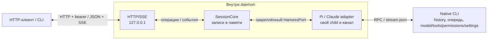

# Локальные сессии Pi и Claude Code

llm-sessiond позволяет внешнему клиенту создавать локальные сессии, передавать native команды и получать события через HTTP/JSON и SSE. В checkout есть командный клиент; импорт TypeScript внешнему потребителю не нужен.

## Кто чем управляет



Daemon владеет локальным lifecycle и собственными child-процессами. Выполнение и native данные принадлежат выбранному CLI; wrapper не становится вторым run/history controller. [Контракт Core](docs/contracts/surfaces/session-core.md), адаптеры [Pi](docs/contracts/surfaces/pi-text-harness.md) и [Claude](docs/contracts/surfaces/claude-code-harness.md).

## Подготовка и проверки

Нужны Node.js **24.x** (проверено на 24.21.0) и npm. При первой подготовке checkout установите зависимости из lockfile:

```sh
npm ci --ignore-scripts --no-audit --no-fund
```

Этот шаг требует npm registry. TypeScript 5.9.3 и @types/node 24.19.2 — локальные devDependencies; глобальный compiler не нужен. В подготовленном checkout:

```sh
npm run typecheck
npm test
npm run test:api-smoke
```

Typecheck выполняет `tsc --noEmit`. Node test runner использует type stripping без сборки; FakePort/Node fake children не запускают Native CLI или модели. [Проверенные платформы и пределы этих проверок](docs/safety-and-validation.md#проверки).

## Минимальный сценарий

Безопасный первый запуск использует **FakePort**, а не Pi/Claude. Он проверяет локальный путь response → stop → shutdown, не завершение модели:

```sh
node --experimental-strip-types --input-type=module <<'JS'
import assert from 'node:assert/strict';
import { SessionCore } from './src/core.ts';
import { FakePort } from './test/fake-port.ts';

const core = new SessionCore(new FakePort());
core.create('demo');
assert.equal((await core.start('demo')).status, 'running');
const response = await core.command('demo', { type: 'prompt', message: 'hello' });
assert.equal(response.success, true);
assert.equal((await core.stop('demo')).status, 'stopped');
await core.shutdown();
console.log('fake-port flow: response → stopped → shutdown');
JS
```

## Перейти к Native сессии

Следуйте [руководству запуска](docs/local-daemon-api.md): приватный config → listener → SSE ready → create/start. Default — Pi; Claude выбирается явно. Нужны доверенный установленный Native CLI и его собственные ресурсы/доступ к provider. Listener/list/create не спавнят child; **start запускает Native с startup hooks и tools с правами child, не в sandbox**.

Bearer обязателен даже на loopback/SSE. Token не передают через argv/env/URL/log; Windows требует приватный ACL. Display и полные native payload не фильтруются от секретов. Локальные записи не переживают restart; written/response не доказывают run completion, unknown cleanup не означает all-cleaned. Полные ограничения — в [безопасности и валидации](docs/safety-and-validation.md).

Для конкретного вопроса: [config](docs/daemon-config.md), [HTTP запросы и ошибки](docs/api-reference.md), [CLI грамматика/exit/EOF](docs/contracts/surfaces/api-cli-client.md), [события](docs/events.md), [native payload и результаты](docs/native-commands.md). [Нормативная граница API](docs/contracts/surfaces/local-daemon-api.md) включает эти справочники.

Перед изменениями прочитайте [обязательный контракт разработки](docs/contracts/development.md) и согласованный feature-контракт. Процесс согласования, review и завершения задаёт [метаконтракт](docs/contracts/meta-contract.md). Merge не означает deployment.
