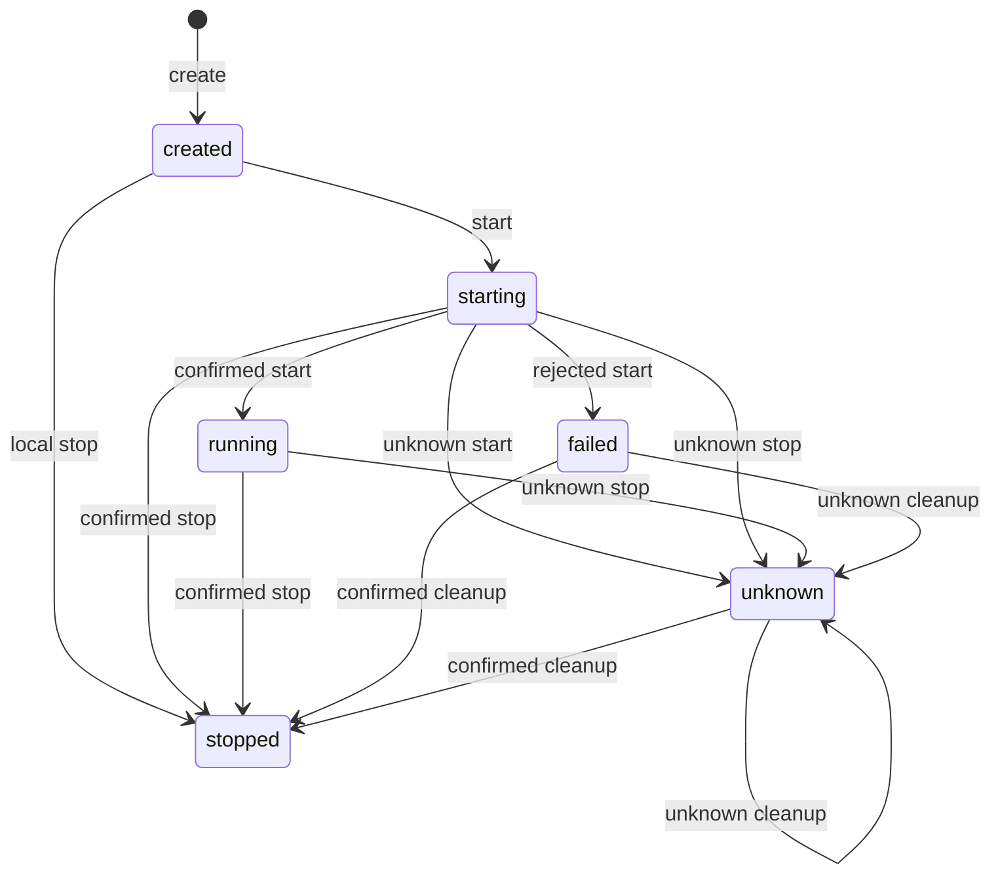

# Ядро сессий

## Граница

`SessionCore` управляет локальными сессиями через `HarnessPort`, не знает native протокола и хранит записи только в памяти. Историей, настройками и выполнением владеет Native CLI.

`new SessionCore(port)` сохраняет вывод типа ответа Pi; create допускается без selector. `new SessionCore(registry)` принимает HarnessRegistry; [createHarnessRegistry](../../../src/harness-registry.ts) получает opaque IDs/default от доверенной composition. Port закрепляется **до публикации create** для всех операций. Изменения map влияют только на будущие create.

[Pi](pi-text-harness.md) и [Claude](claude-code-harness.md) владеют своими процессами/каналами; [daemon](local-daemon-api.md) предоставляет HTTP/SSE. Полные определения [событий](../../events.md), [native семантики](../../native-commands.md), [безопасности и проверок](../../safety-and-validation.md) — обязательные части контракта.

## Операции и состояния

Повторный create даёт `duplicate-session`; неизвестный модуль — `harness-rejected` без записи, события или эффекта. Start возможен только из created; rejected даёт `harness-rejected`, unknown — `harness-unknown`.

Command допускается в running без stop. Параметры неизменны; результат — полный record либо local written. `NativeResponse` описывает Pi, не общий envelope. Native ошибка остаётся ответом; потерянный ответ даёт `harness-unknown`, неподдерживаемый compact — `harness-rejected`. Команды конкурентны, сессии независимы. Собственных очереди, input/run coordinator, idle admission или used IDs нет. Stop не abort RPC.

Get/list возвращают `{sessionId,status}`; явный selector добавляет `harness`, включая default. Это не history/run/liveness. Изменение list не меняет карту; команды и ответы клонируются и глубоко замораживаются.

Reply допустим в starting/running без stop. Отсутствующий port.reply даёт rejected, исключение — unknown без приватной причины. Written означает callback+drain, не ACK. После stop/смены поколения поздний результат становится unknown; ошибки admission отдельны.

`CoreError.code`: `closed`, `duplicate-session`, `session-not-found`, `invalid-state`, `harness-rejected`, `harness-unknown`; private причины не раскрываются. [Сигнатуры](../../../src/core.ts), [типы](../../../src/types.ts).

## Остановка и завершение работы

Stop для created локален, без порта; для stopped отклоняется, restart запрещён. Failed/unknown очищаются через исходный port. Пока stop выполняется, конкурентный cleanup даёт unknown без второго port.stop.

Confirmed возвращает SessionView stopped. Unknown или исключение дают unknown и `harness-unknown`. Rejected даёт `harness-rejected`; запрет снимается только без прежней неопределённости. Поздний start не оживляет stopped/unknown. После rejected stop без прежней неопределённости результат start применим.

После завершённого unknown новый явный stop или первый shutdown достигает harness. Rejected новой попытки сохраняет прежнюю неопределённость и запрет команд. Автоматических retry/replay/fallback нет.

Shutdown синхронно закрывает create/start/command/reply/stop/get/list/subscribe (`closed`). Начатые операции могут закончиться; полученный ответ сохраняется, потерянный не выдумывается. Единственный обход пропускает только stopped. Сводка содержит IDs **этого обхода**: `stoppedSessionIds` для confirmed, `uncertainSessionIds` для unknown, `failedSessionIds` для rejected. Это не история или завершение модели/всех конкурентных операций.

Повторный shutdown возвращает тот же Promise и результат, не новый cleanup. После closed публичный stop недоступен. [Подтверждение выхода и пределы очистки](../../safety-and-validation.md#остановка) обязательны. [Реализация гонок](../../../src/harness-session.ts).

## События и ограничения

Subscribe не даёт replay. Источник задаёт callback start, не native file identity. Поля, gates, snapshots, получатели, FIFO и изоляция подписчиков полностью определены в [правилах доставки](../../events.md#маршрут-и-доставка). Представления не раскрывают private records/config/stderr. Payload не фильтруется от секретов; Core не логирует prompts.

[Нецели и пределы проверки](../../safety-and-validation.md) обязательны; универсального контроллера нет. Процесс изменений: [development](../development.md), [метаконтракт](../meta-contract.md).
